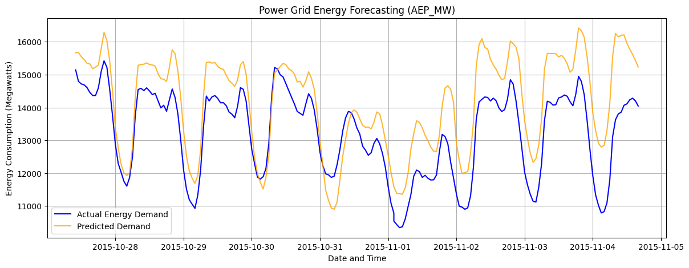

# Power Grid Energy Forecasting ⚡

## Objective
A machine learning pipeline built to predict hourly energy consumption on the power grid. Accurate load forecasting is critical for optimizing energy distribution, preventing grid overloads, and managing infrastructure efficiently.

## Tech Stack
* **Language:** Python
* **Libraries:** Scikit-Learn, Pandas, Matplotlib
* **Environment:** Google Colab

## Methodology
1. **Data Processing:** Handled time-series data from the Hourly Energy Consumption dataset, converting raw timestamps into analyzable chronological formats.
2. **Feature Engineering:** Extracted temporal features (Hour, Day of Week, Month, Day of Year) to allow the model to learn daily and seasonal power usage patterns.
3. **Model Selection:** Implemented a **Random Forest Regressor** to handle non-linear relationships in the time-series data.
4. **Evaluation:** Split data chronologically (80% training, 20% testing) to prevent data leakage and evaluated using Mean Absolute Error (MAE).

## Results
The model successfully identifies daily peak load cycles and seasonal baseline shifts. Below is a plot comparing the predicted energy demand against actual grid consumption over a 200-hour test window.

*Dataset sourced from Kaggle's Hourly Energy Consumption data.*
